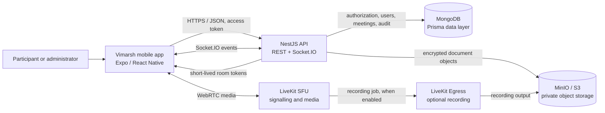
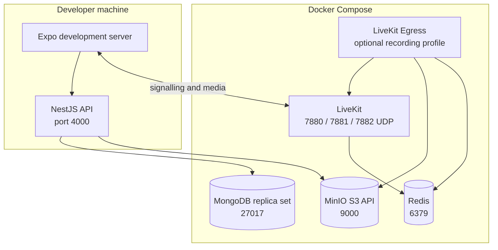
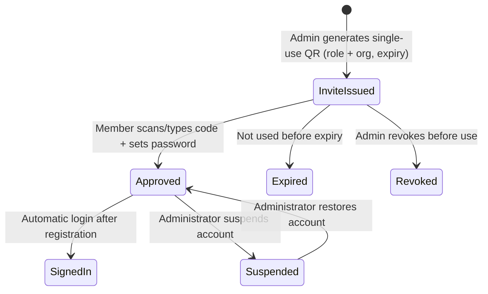
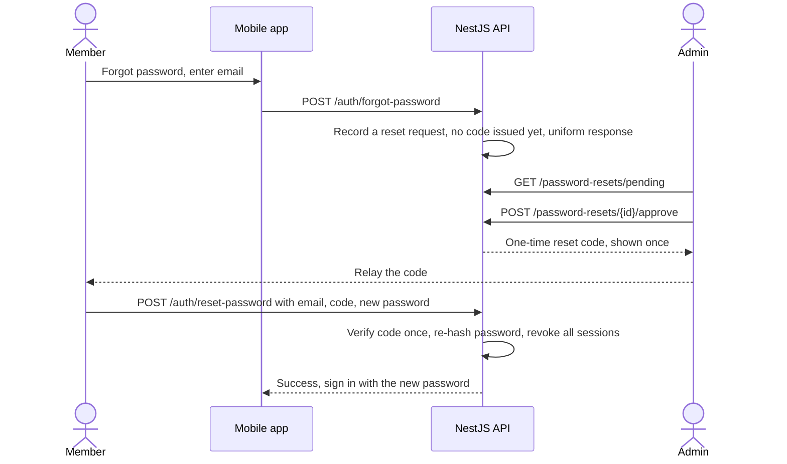
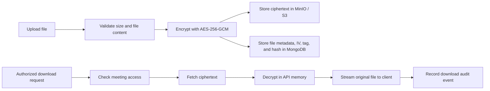
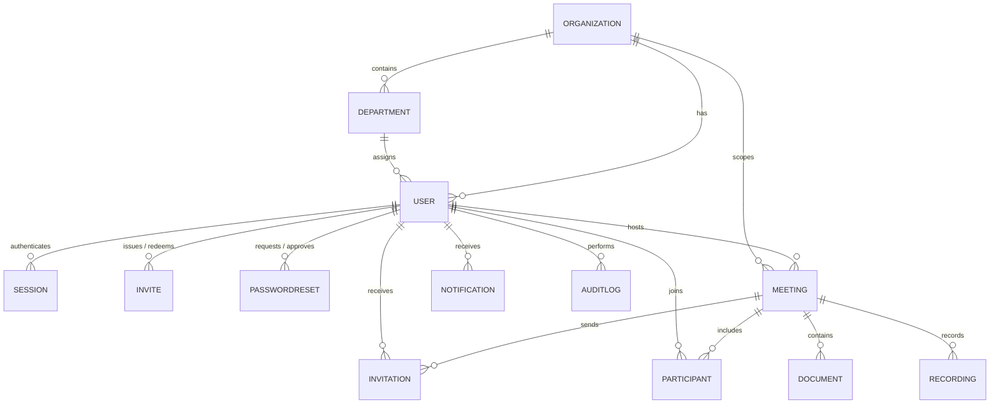

# Vimarsh

Vimarsh is a secure meeting and collaboration platform for India's technical education ecosystem. It brings organization-aware accounts, approval workflows, scheduled meetings, live video, participant controls, and protected meeting documents together in one mobile-first application.

This repository contains an Expo / React Native client, a NestJS API, and local infrastructure for MongoDB, LiveKit, and S3-compatible object storage.

## At a glance

- Organization-scoped accounts and role-based access for AICTE, ministries, institutes, departments, faculty, and guests.
- Admin-issued, single-use QR invitation onboarding (no email or OTP), admin-controlled password reset, and refreshable login sessions with instant server-side revocation.
- Meeting scheduling, invitations, waiting rooms, participant management, and live conferencing.
- Socket.IO events for meeting chat, participant updates, and host controls.
- Meeting documents encrypted at rest and served only after an access check.
- Audit events for sensitive operations.

## System architecture



The API is the authority for identity, permissions, meeting state, and document access. LiveKit carries real-time audio and video; the client receives a short-lived room token from the API only after meeting admission. Document bytes are encrypted before they are stored in the object store. Onboarding and password recovery are entirely admin-controlled, so the authentication flow needs no SMTP or external messaging service.

### Local development services



The API and Expo app run on the host during development. Docker Compose provides MongoDB, Redis, LiveKit, and MinIO. Egress is optional and is started only when testing server-side recording.

## Main workflows

### Account onboarding (admin-issued QR invitation)

Registration is gated by a single-use, time-limited invitation an administrator generates and renders as a QR code. There is no email or OTP step. Redeeming the invitation is atomic (a code can be used exactly once, even under concurrent requests) and the new account is created already approved with the role and organization the admin chose, then signed in automatically.



The mobile app chooses its navigation tree from the authenticated account state: signed-out users see authentication screens (including the invitation scanner), and approved users see the main application. The administrator approval workflow remains available for role changes and for suspending or restoring accounts.

### Password reset (admin-controlled, no email)



The reset code is random, time-limited (60 minutes), single-use, and stored only as a SHA-256 hash. It appears exactly once — in the approval response — and never in listings, logs, database rows, or error messages. Completing a reset revokes all of the member's sessions, so previously issued tokens stop working immediately (see instant revocation below).

### Joining a live meeting

```mermaid
sequenceDiagram
    actor Participant
    participant App as Mobile app
    participant API as NestJS API
    participant Host
    participant LiveKit

    Participant->>App: Request to join meeting
    App->>API: POST /meetings/{id}/join-request
    API->>API: Check access, passcode, capacity, and meeting state
    alt Waiting room enabled
        API-->>Host: Waiting-room request event
        Host->>API: Admit or deny participant
        API-->>App: Admitted or denied
    else Join is allowed directly
        API-->>App: Join request accepted
    end
    App->>API: POST /meetings/{id}/token
    API->>API: Verify participant admission
    API-->>App: Short-lived LiveKit room token
    App->>LiveKit: Connect with room token
    LiveKit-->>App: Live audio and video
```

### Protected document handling



The API does not expose a raw object-store URL for protected documents. Upload scanning is marked `SKIPPED` when no malware-scanner provider is configured; configure a provider before relying on scanning in a deployment.

## Capabilities

| Area | What it covers |
| --- | --- |
| Accounts and access | QR invitation registration (single-use, time-limited), admin-controlled password reset, session refresh with instant revocation, account status, roles, and organization scoping |
| Organization workflows | Organizations, departments, member onboarding invites, approvals, and meeting invitations |
| Meetings | Scheduling, listing, invitations, policies, passcodes, waiting rooms, admission, participant actions, and cancellation |
| Live collaboration | LiveKit room tokens and Socket.IO events for chat, participant changes, raised hands, and host controls |
| Documents | Content-based file validation, encrypted object storage, access-controlled downloads, integrity hashes, and audit events |
| Notifications and audit | In-app notifications and records of significant actions |
| Mobile app | Authentication, onboarding, home and calendar, meetings, meeting rooms, documents, notifications, and administration screens |

The backend's role enum includes `SUPER_ADMIN`, `MINISTRY`, `INSTITUTE_ADMIN`, `HOD`, `FACULTY`, and `GUEST`. Exact permissions are enforced by the API; the mobile navigation is not a substitute for server-side authorization.

## Technology

- **Mobile:** Expo, React Native, TypeScript, React Navigation, TanStack Query, LiveKit React Native, Socket.IO client.
- **Backend:** NestJS, TypeScript, Prisma, REST, Socket.IO, Swagger.
- **Data:** MongoDB configured as a single-node replica set for Prisma transactions.
- **Media:** LiveKit for real-time rooms; optional LiveKit Egress for recordings.
- **Object storage:** MinIO for local development and S3-compatible deployments.
- **Security controls:** Argon2id password hashing, JWT access/refresh sessions with instant server-side session revocation (every authenticated request verifies the session is still active), admin-issued single-use onboarding and password-reset codes (stored only as SHA-256 hashes), request validation, throttling, role guards, audit logging, and AES-256-GCM document encryption at rest.
- **QR onboarding (mobile):** `react-native-svg` + `react-native-qrcode-svg` to render invitation QR codes, and `expo-camera` to scan them (manual code entry is always available as a fallback).

## Repository layout

```text
.
├── backend/
│   ├── prisma/             # Data model and bootstrap seed
│   ├── scripts/            # API, security, and integration test scripts
│   └── src/                # NestJS modules and shared infrastructure
├── livekit/                # LiveKit and Egress configuration
├── mobile/
│   ├── assets/             # App icons and branding
│   └── src/
│       ├── api/             # API client and endpoint definitions
│       ├── auth/            # Authentication state and secure token storage
│       ├── components/      # Shared UI components
│       ├── navigation/      # Authenticated and role-aware navigation
│       └── screens/         # Auth, meetings, live room, and admin screens
├── docker-compose.yml      # Local infrastructure
└── .env.example             # Backend and infrastructure environment template
```

## Getting started

### Prerequisites

- Node.js and npm compatible with the lockfiles in `backend/` and `mobile/`.
- Docker with the Compose plugin.
- An Android or iOS development environment for native device builds. Expo web can be used for supported screens, but it does not replace native testing for WebRTC features.

### 1. Configure local environment

From the repository root:

```sh
cp .env.example .env
cp mobile/.env.example mobile/.env
```

Edit `.env` before starting the application. In particular:

- Generate a 32-byte document key, for example with `openssl rand -hex 32`, and set `DOCUMENT_ENCRYPTION_KEY`.
- Replace the development JWT secrets with random values.
- Set a unique `SEED_SUPER_ADMIN_PASSWORD` for your local bootstrap administrator.

SMTP is not required: onboarding and password reset are admin-controlled and send no email. Any `SMTP_*` settings are legacy and unused by the current authentication flow.

The example file contains development defaults. Do not use them in a deployed environment or commit real credentials.

### 2. Start supporting services

From the repository root:

```sh
docker compose up -d mongo redis livekit minio
docker compose ps
```

For server-side meeting recording, start the optional Egress service separately:

```sh
docker compose --profile recording up -d livekit-egress
```

### 3. Install backend dependencies and initialize the database

```sh
cd backend
npm ci
set -a
source ../.env
set +a
npm run prisma:generate
npm run prisma:push
npm run seed
```

The seed is idempotent and creates an AICTE organization, a sample institute and department, and the configured bootstrap Super Admin. Outside production it also prints a development demo invitation code so the QR registration flow can be exercised without first signing in as an administrator. The seed prints the development account email and password; keep those credentials private and change them from the example values.

### 4. Run the API

From `backend/`:

```sh
npm run start:dev
```

The API listens on port `4000` by default. Swagger API documentation is available at [http://localhost:4000/docs](http://localhost:4000/docs).

### 5. Run the mobile app

In another terminal:

```sh
cd mobile
npm ci
npm start
```

For Expo Go on the same Wi-Fi network, the app can derive the API host from the Expo development server. For a physical-device build or a different network, set `EXPO_PUBLIC_API_URL` in `mobile/.env` to an address reachable from the device, such as `http://192.168.1.50:4000`. `localhost` on a physical phone refers to the phone itself, not the development computer.

Useful mobile commands:

```sh
npm run android
npm run ios
npm run web
npm run typecheck
```

Native builds require the corresponding Android or iOS toolchain.

## API and realtime overview

The API uses bearer access tokens for protected REST endpoints. The exact request and response schemas are available in Swagger at `/docs`.

| Route group | Examples |
| --- | --- |
| Authentication | `POST /auth/register` (requires an invitation code), `/auth/login`, `/auth/refresh`, `/auth/logout`, `/auth/forgot-password`, `/auth/reset-password` |
| Onboarding invites (admin) | `POST /invites`, `GET /invites`, `POST /invites/:id/revoke`, `POST /invites/validate` (public pre-check) |
| Password recovery (admin) | `GET /password-resets/pending`, `POST /password-resets/:id/approve`, `POST /password-resets/:id/reject` |
| Meetings | `GET /meetings`, `POST /meetings`, `POST /meetings/:id/join-request`, `POST /meetings/:id/token` |
| Documents | `POST /meetings/:id/documents`, `GET /meetings/:id/documents`, `GET /documents/:id/download` |
| Health | See the health endpoints in Swagger |

The Socket.IO gateway authenticates connections with an access token supplied as `auth.token`. Events include `meeting:subscribe`, `chat:send`, `hand:raise`, `waiting:request`, `waiting:admitted`, `waiting:denied`, `participant:update`, `meeting:lock`, and `meeting:ended`. Meeting access and participant state should be established through the REST API before relying on meeting events.

## Data model



The Prisma schema is the source of truth for persisted entities and enums. Meetings, invitations, participants, documents, recordings, notifications, and audit records are related to users and organizations to support scoped access and traceability. Onboarding invites and password-reset requests store only SHA-256 hashes of their one-time codes, never the plaintext. (The legacy `Otp` model remains in the schema but is no longer used by the authentication flow.)

## Tests and checks

The backend includes API-oriented scripts for smoke/authentication, security checks, meetings, LiveKit, Socket.IO realtime, documents, and encryption. Most scripts expect a running API and local services.

With the API running on `http://localhost:4000`, execute the aggregate suite from `backend/`:

```sh
./scripts/run-all-tests.sh
```

You can pass a different API base URL and log path:

```sh
./scripts/run-all-tests.sh http://localhost:4000 /tmp/vimarsh-api.log
```

Run the mobile TypeScript check from `mobile/`:

```sh
npm run typecheck
```

## Configuration and deployment notes

- Root `.env.example` documents backend and Compose settings; `mobile/.env.example` documents the mobile API URL.
- Keep JWT secrets, object-store credentials, LiveKit keys, and `DOCUMENT_ENCRYPTION_KEY` private.
- Back up the document encryption key securely. Existing encrypted documents cannot be decrypted without the key used to encrypt them.
- Configure `CORS_ORIGINS` for the intended clients instead of leaving a permissive development setting in production.
- Set a reachable LiveKit URL and matching API key/secret for the API and LiveKit server. The LiveKit secret belongs on the server, not in the mobile app.
- For physical-device media tests, configure LiveKit's advertised node IP for the development machine's LAN address and ensure the required media ports are reachable.
- Egress is optional. Enable its Compose profile only when recording is needed.
- SMS, push, and malware scanning are provider integration points; empty provider configuration does not mean those external services are active.
- The authentication flow (registration, login, password reset) requires no SMTP or outbound email, so the platform runs on hosts that block outbound SMTP, including free PaaS tiers.

### Deployment reference

The project has been deployed with the API on [Render](https://render.com) and MongoDB on [MongoDB Atlas](https://www.mongodb.com/atlas) (a replica set, required by Prisma transactions). Notes for that setup:

- Build command installs dev dependencies, generates the Prisma client, builds, and syncs the schema, for example: `npm install --include=dev && npx prisma generate && npm run build && npx prisma db push`. Installing dev dependencies matters because `NODE_ENV=production` otherwise skips them and `nest`/`prisma` are unavailable at build time.
- The API binds `0.0.0.0` and reads `PORT` from the environment, so it works behind a managed host's port assignment.
- Set `DATABASE_URL` to the Atlas connection string, and set the JWT secrets, `DOCUMENT_ENCRYPTION_KEY`, LiveKit URL/keys, and `CORS_ORIGINS` as deployment environment variables.
- Point the mobile app at the deployed API by setting `EXPO_PUBLIC_API_URL` in `mobile/.env` before building a release APK/IPA.
- Free tiers may idle the service; the first request after idle can take tens of seconds to wake.

## License

The mobile app directory contains a `LICENSE` file. Review the applicable license terms before redistributing this project or its assets.
