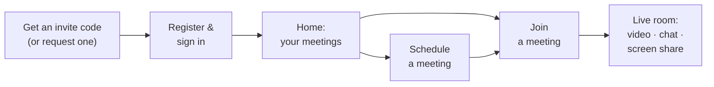
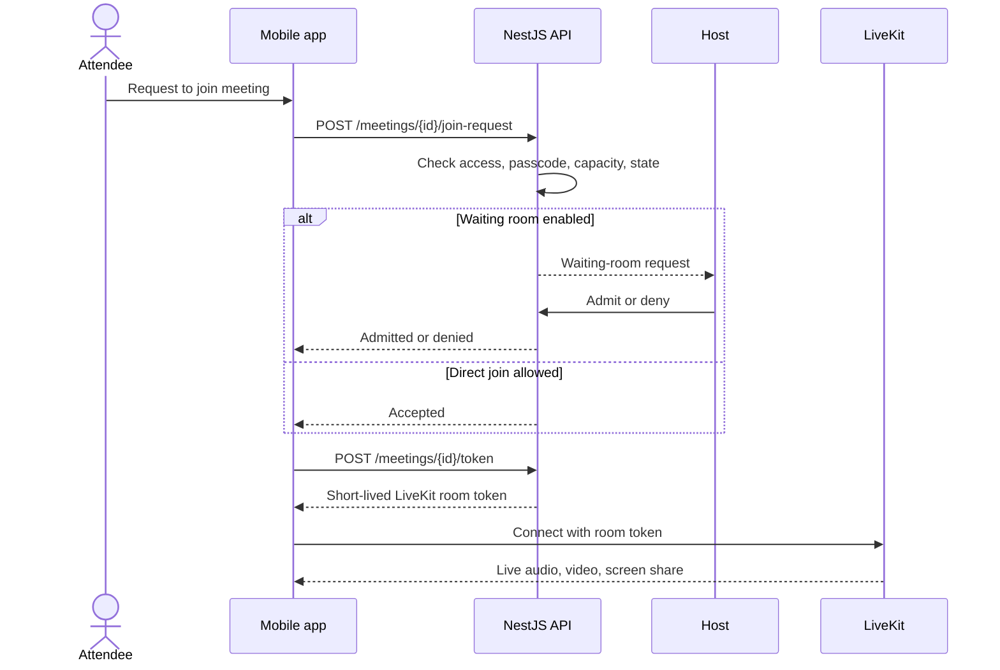

# Vimarsh

Vimarsh is a secure meeting platform for India's technical education ecosystem. It brings organization-aware accounts, admin-controlled onboarding, scheduled meetings, live video with host controls, and protected meeting documents together in one mobile-first app.

This repository contains an **Expo / React Native** client, a **NestJS** API, and local infrastructure for **MongoDB**, **LiveKit**, and S3-compatible object storage. In production the API runs on Render, data on MongoDB Atlas, and media on LiveKit Cloud; the app ships as an Android APK built with EAS.

## At a glance

- **Accounts & roles** — organization-scoped accounts across six roles (`SUPER_ADMIN`, `MINISTRY`, `INSTITUTE_ADMIN`, `HOD`, `FACULTY`, `GUEST`). Permissions are enforced by the API; mobile navigation is not a substitute for server-side authorization.
- **Onboarding without email** — admins issue single-use, time-limited QR invitation codes. A prospective user can also tap **“Ask for a code”** on the register screen, which notifies admins in-app. Password reset is admin-approved. No SMTP/OTP anywhere.
- **Meetings** — scheduling (admins, HODs, **faculty, and guests**), invitations to **registered members**, passcodes, waiting rooms, and admission. Local reminders fire **1 minute before** each meeting.
- **Live room (LiveKit)** — camera, microphone, **screen share**, in-meeting **chat**, **raise hand**, and a lean control bar. The screen stays awake during a meeting.
- **Host controls** — admit from the waiting room, **mute-all with request-to-unmute**, **add a participant mid-meeting**, and **end for everyone** (vs. leaving yourself).
- **Admin tools** — registration approvals, invite management, **suspend/restore member access**, password-reset approvals, and a tamper-evident audit log.
- **Documents & recording** — meeting documents encrypted at rest and served only after an access check; optional server-side recording (LiveKit Egress), shown in a meeting’s detail when enabled.
- **Sessions** — JWT access/refresh with **instant server-side revocation** (every request re-checks the session).

## How it works

A quick path through the app, from first launch to a live meeting:



Behind the app, the NestJS API is the authority for identity, permissions, meeting state, and documents; LiveKit carries real-time audio, video, and screen share; data lives in MongoDB with files in S3-compatible storage. Onboarding and password recovery are admin-controlled, so no SMTP or OTP is involved.

## Main workflows

### Onboarding (admin-issued QR invitation)

Registration is gated by a single-use, time-limited invitation an admin generates and renders as a QR code — no email or OTP. Redeeming is atomic (a code is used exactly once, even under concurrent requests); the account is created already approved with the admin-chosen role and organization, then signed in automatically. A new user with no code can request one from the register screen, which notifies admins. Admins can later suspend or restore a member's access.

### Password reset (admin-approved, no email)

```mermaid
sequenceDiagram
    actor Member
    participant App as Mobile app
    participant API as NestJS API
    actor Admin

    Member->>App: Forgot password, enter email
    App->>API: POST /auth/forgot-password
    API->>API: Record request, uniform response, no code yet
    Admin->>API: GET /password-resets/pending
    Admin->>API: POST /password-resets/{id}/approve
    API-->>Admin: One-time reset code, shown once
    Admin-->>Member: Relay the code
    Member->>API: POST /auth/reset-password (email, code, new password)
    API->>API: Verify once, re-hash, revoke all sessions
    API-->>App: Success; sign in with new password
```

The reset code is random, 60-minute, single-use, and stored only as a SHA-256 hash. It appears exactly once (in the approval response) — never in listings, logs, or errors. Completing a reset revokes all of the member's sessions immediately.

### Joining a live meeting



**In the room**, the control bar is intentionally lean: microphone, camera, screen share, raise hand, chat, and leave. A host additionally admits waiting attendees, toggles **mute-all** (participants then send a request-to-unmute the host approves), adds a participant mid-meeting, and can **end the meeting for everyone**. Waiting-room state, chat, and host actions ride Socket.IO; media rides LiveKit.

## Capabilities

| Area | What it covers |
| --- | --- |
| Accounts & access | QR-invitation registration, request-a-code onboarding, admin password reset, session refresh with instant revocation, roles, and organization scoping |
| Organization & admin | Organizations and departments, registration approvals, invite management, member suspend/restore, and audit log |
| Meetings | Scheduling, listing, invitations to registered members, policies, passcodes, waiting rooms, admission, reminders, and cancellation |
| Live room | LiveKit audio/video/screen share plus Socket.IO chat, raised hands, mute-all/request-to-unmute, add-participant, and end-for-all |
| Documents & recording | Content-validated, AES-256-GCM-encrypted documents with access-checked downloads; optional server-side recording (LiveKit Egress) |
| Notifications & audit | In-app notifications, local meeting reminders, and records of significant actions |

## Technology

- **Mobile:** Expo, React Native, TypeScript, React Navigation, TanStack Query, LiveKit React Native (`@livekit/react-native` + `@livekit/react-native-webrtc`), Socket.IO client, `expo-notifications` (reminders), `expo-keep-awake`, `react-native-qrcode-svg` + `expo-camera` (QR onboarding).
- **Backend:** NestJS, TypeScript, Prisma, REST + Socket.IO, Swagger.
- **Data:** MongoDB as a single-node replica set (required by Prisma transactions).
- **Media:** LiveKit for real-time rooms (LiveKit Cloud in production); optional LiveKit Egress for recordings. Screen share uses an Android `mediaProjection` foreground service.
- **Object storage:** MinIO locally; any S3-compatible store in deployment.
- **Security:** Argon2id password hashing, JWT access/refresh with instant server-side session revocation, admin-issued single-use onboarding and reset codes (SHA-256-hashed), request validation, throttling, role guards, audit logging, and AES-256-GCM document encryption at rest.

## Repository layout

```text
.
├── backend/
│   ├── prisma/             # Data model and bootstrap seed
│   ├── scripts/            # API, security, and integration test scripts
│   └── src/                # NestJS modules (auth, meetings, realtime, documents, …)
├── livekit/                # LiveKit and Egress configuration
├── mobile/
│   └── src/
│       ├── api/            # API client and endpoint definitions
│       ├── auth/           # Auth state and secure token storage
│       ├── realtime/       # Socket.IO client and meeting reminders
│       ├── navigation/     # Role-aware navigation
│       └── screens/        # Auth, meetings, live room, and admin screens
├── downloads/              # Built release APK
├── docker-compose.yml      # Local infrastructure
└── .env.example            # Backend / infrastructure environment template
```

## Getting started

**Prerequisites:** Node.js + npm matching the lockfiles, Docker with Compose, and an Android/iOS toolchain for native device builds (Expo web does not replace native testing for WebRTC).

```sh
# 1. Configure environment (edit secrets before starting)
cp .env.example .env
cp mobile/.env.example mobile/.env
#   In .env set DOCUMENT_ENCRYPTION_KEY (openssl rand -hex 32),
#   random JWT secrets, and SEED_SUPER_ADMIN_PASSWORD.

# 2. Start infrastructure
docker compose up -d mongo redis livekit minio
#   Optional server-side recording:
#   docker compose --profile recording up -d livekit-egress

# 3. Backend: install, init DB, seed, run
cd backend
npm ci
set -a; source ../.env; set +a
npm run prisma:generate && npm run prisma:push && npm run seed
npm run start:dev           # API on :4000, Swagger at /docs

# 4. Mobile (new terminal)
cd mobile
npm ci
npm start                    # also: npm run android | ios | web | typecheck
```

The seed is idempotent: it creates an AICTE organization, a sample institute/department, and the bootstrap Super Admin, and (outside production) prints a demo invitation code and the dev account credentials — keep them private and change them from the example values.

For a physical device, set `EXPO_PUBLIC_API_URL` in `mobile/.env` (or in `eas.json` for EAS builds) to an address the device can reach — `localhost` on a phone is the phone itself, not your computer.

## API & realtime overview

Protected REST endpoints use bearer access tokens; full schemas live in Swagger at `/docs`.

| Route group | Examples |
| --- | --- |
| Authentication | `POST /auth/register` (needs invite), `/auth/login`, `/auth/refresh`, `/auth/logout`, `/auth/forgot-password`, `/auth/reset-password`, `POST /auth/request-access` |
| Onboarding invites (admin) | `POST /invites`, `GET /invites`, `POST /invites/:id/revoke`, `POST /invites/validate` (public) |
| Users & members (admin) | `GET /users/directory`, `GET /users/members`, `POST /users/:id/suspend`, `POST /users/:id/restore` |
| Password recovery (admin) | `GET /password-resets/pending`, `POST /password-resets/:id/approve`, `POST /password-resets/:id/reject` |
| Meetings | `GET /meetings`, `POST /meetings`, `POST /meetings/:id/invitations`, `POST /meetings/:id/join-request`, `POST /meetings/:id/token` |
| Documents & recording | `POST /meetings/:id/documents`, `GET /meetings/:id/documents`, `GET /documents/:id/download`, `POST /meetings/:id/recording/start` |

The Socket.IO gateway authenticates with an access token in `auth.token`. Events include `meeting:subscribe`, `chat:send`, `hand:raise`, `waiting:request`, `waiting:admitted`/`waiting:denied`, `participant:update`, `host:mute_all` → `room:mute_all`, `unmute:request`, `host:allow_unmute`, `host:mute`, and `meeting:ended`. Establish meeting access and participant state through REST before relying on events.

## Data model

The Prisma schema (`backend/prisma`) is the source of truth for persisted entities and enums — organizations, departments, users, sessions, invites, password resets, meetings, invitations, participants, documents, recordings, notifications, and audit logs — all scoped to users and organizations. Onboarding invites and password-reset requests store only SHA-256 hashes of their one-time codes, never plaintext.

## Tests & checks

With the API running on `http://localhost:4000`, run the aggregate backend suite (smoke/auth, security, meetings, LiveKit, realtime, documents, encryption) from `backend/`:

```sh
./scripts/run-all-tests.sh            # or: ./scripts/run-all-tests.sh <api-url> <log-path>
```

Run the mobile TypeScript check from `mobile/`: `npm run typecheck`.

## Deployment notes

- Keep JWT secrets, object-store credentials, LiveKit keys, and `DOCUMENT_ENCRYPTION_KEY` private, and back up the document key — encrypted documents cannot be recovered without it.
- Set `CORS_ORIGINS` to the intended clients; don't ship the permissive dev default.
- Set a reachable LiveKit URL with a **matching API key/secret** on both the API and the LiveKit server (Cloud or self-hosted). The LiveKit secret stays on the server, never in the app.
- Point the app at the deployed API via `EXPO_PUBLIC_API_URL` (in `eas.json` `env` for EAS builds, so it is baked into the APK) before building a release.
- **Reference deployment:** API on [Render](https://render.com), MongoDB on [Atlas](https://www.mongodb.com/atlas), media on LiveKit Cloud. Render build, e.g.: `npm install --include=dev && npx prisma generate && npm run build && npx prisma db push` (dev deps are needed so `nest`/`prisma` exist at build time). Free tiers may idle; the first request after idle can take tens of seconds.
- Android release APKs are built with **EAS Build** (`eas build -p android --profile preview`) and distributed as a direct artifact link or via GitHub Releases. The login screen shows a build tag so the installed build is unambiguous.

## License

The mobile app directory contains a `LICENSE` file. Review the applicable terms before redistributing this project or its assets.
